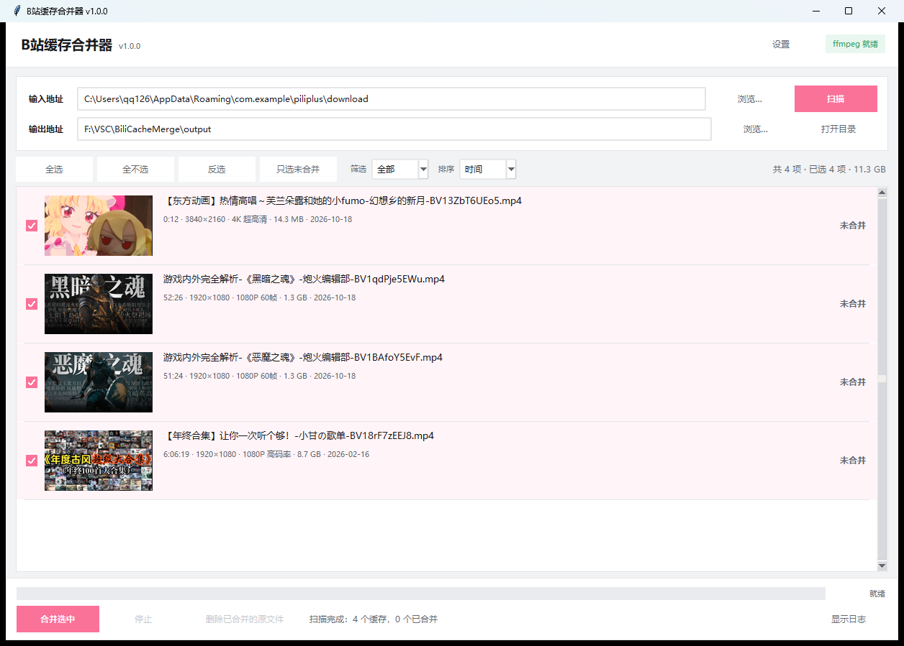

# BiliCacheMerge

[中文说明](README.md)

Losslessly merges a **PiliPlus** offline download cache (`video.m4s` + `audio.m4s`) into a single MP4,
and embeds the cached `cover.jpg` as the MP4 cover art.

- **No re-encoding** (`ffmpeg -c copy`): a 1.3 GB / 51-minute video takes about 4 seconds — zero quality loss.
- Understands the cache layout only; **danmaku is ignored** (`danmaku.pb`).



> The application UI is in Chinese. Menu names below are given in English with the Chinese label in
> parentheses, e.g. Settings (`设置`).

---

## 0. Scope and notice (read first)

- This tool has only been tested against **PiliPlus** caches (layout in section 5).
  **The official Bilibili client, other third-party clients and other downloaders have not been tested.**
  The program only recognises directories that contain `entry.json` **and** a `video.m4s`;
  anything else is skipped — **it will not touch files belonging to other applications**.
- Built with the assistance of **DeepSeek Harness (DSH)**.
  **There is no maintenance**: no further updates, no bug fixes, no new features.
  The behaviour described here is that of v1.0.0. The code is a single plain-Python file, so you can modify it yourself.
- You are responsible for anything that happens when you use this tool — especially
  "Delete merged source files" (`删除已合并的原文件`).

---

## 1. Running it

**Double-click `BiliCacheMerge.exe`** (no console window).

`BiliCacheMerge.exe` is a tiny launcher: it locates Python on your machine and starts the UI.
Therefore **the `.exe` must stay in the same folder as `BiliCacheMerge.py`** (that is the default layout —
do not copy the exe away on its own). If your antivirus blocks the exe, just run `python BiliCacheMerge.py`;
the result is identical.

Manual start:

```bat
python BiliCacheMerge.py
```

Requirements: Windows + Python 3.8 or newer (tkinter included; verified on 3.11 / 3.13).
ffmpeg is bundled at `bin\ffmpeg.exe`, so nothing else needs to be installed.

> **Where you put this folder matters**
>
> Keep the folder in a **normal directory** (e.g. `D:\BiliCacheMerge`, `G:\BiliCacheMerge`,
> `C:\Users\<you>\BiliCacheMerge`).
> If it sits in a directory carrying a **low-integrity** security label (some sandboxes / agent workspaces
> label their workspace that way), the exe inherits that label, and Windows starts it at low integrity.
> Symptoms: **the UI opens and scanning works, but every merge fails with `Permission denied` /
> "output folder not writable", and only the program's own folder is writable**.
>
> Two ways out:
> 1. move the whole folder to a normal directory (recommended);
> 2. or double-click `启动.vbs` (no window) / `调试启动.bat` (console) in the same folder —
>    these do not go through the exe and are not downgraded.
>
> How to tell: if a **yellow banner** appears under the title bar, you are running in a restricted environment.

---

## 2. Usage

| Step | Action |
| --- | --- |
| 1 | **Input path**: point it at PiliPlus's cache root. **Strongly recommended: change PiliPlus's cache path to a data drive first** (Settings → Other settings → Cache path, i.e. `设置 → 其他设置 → 缓存路径`) and use that folder here — see section 5. If you keep the default, it is `C:\Users\<you>\AppData\Roaming\com.example\piliplus\download` (pick the `download` level, or a single video folder). **Don't know where the cache is? See "How to find the cache folder" in section 5.** |
| 2 | **Output path**: where the MP4 files go. Use "Browse…" (`浏览…`) or "Open folder" (`打开目录`). |
| 3 | Press **Scan** (`扫描`). Each row shows the cover thumbnail, the file name that will be produced, duration / resolution / quality / size / cache date / status. |
| 4 | Tick the items to merge (Select all / none / invert / only-unmerged are available; `Ctrl+A` selects all). |
| 5 | Press **Merge selected** (`合并选中`); the progress bar and status bar show progress, finished rows become "merged" (`已合并`). |
| 6 | To free up space press **Delete merged source files** (`删除已合并的原文件`) — you must tick "I know what I'm doing" and wait for a 5-second countdown before the delete button activates (the MP4s are never touched; **restart PiliPlus afterwards**, see section 5). |

> The first time you open the app (or when a path box is empty) the two path fields show a
> **light-grey placeholder hint**; it disappears as soon as you type or pick a folder, and never
> shows while the field has content.

The toolbar on the right sorts by **Name / Time / Size / Duration / Status**
("Time" = cache download time, newest first) and filters by **all / unmerged / merged**.

After a merge finishes the app does **not** open Explorer automatically (off by default).
To enable it, tick "Open output folder after merging" in **Settings**; even if opening fails,
it is only written to the log, never an error dialog.

Tip: **double-click a row** to open the merged MP4; for an unmerged row it opens the cache folder.

---

## 3. File naming

```
Collection name (if any)-Title-Uploader-av/BV number
```

| Case | Result |
| --- | --- |
| Ordinary video | `【东方动画】热情高唱～芙兰朵露和她的小fumo-幻想乡的新月-BV13ZbT6UEo5.mp4` |
| Video inside a collection | `游戏内外完全解析-《恶魔之魂》-炮火编辑部-BV1BAfoY5EvF.mp4` |
| No BV number | `av` + avid is used instead |
| Multi-part video | `P1` / `P2` … are appended when pages share a title |

Characters that are illegal in Windows file names (`\ / : * ? " < > |`) are replaced, and over-long
titles are truncated while keeping the uploader and the video ID.

---

## 4. Cover art / thumbnails

During a merge, `cover.jpg` is written as the **MP4 `covr` cover** (`-disposition:v:1 attached_pic`),
together with `title / artist / album / comment` metadata (`album` = collection name).

- **Players and media libraries that read cover art** (Kodi, Plex, Emby, iTunes, some phone galleries,
  some player skins) will display it.
- **Windows Explorer** generates the thumbnail of a *video file* by decoding its first frame; it does not
  read embedded cover art (that is OS behaviour, unrelated to how the cover was written).
  If you want to see the cover in a folder, tick "Also save a `<name>.jpg` next to the output" in **Settings**.
- If you don't want cover art, turn off "Write cover.jpg into the MP4 cover" in **Settings**.

The row thumbnails are produced by scaling `cover.jpg` with ffmpeg and caching them under `thumbs\`.
If that fails, a coloured tile with the first character of the title is used instead, and the reason is
written to the log (press **Show log** / `显示日志`).

---

## 5. PiliPlus cache layout (what the program looks for)

```
<cache root>/
└── 117230125849363/            avid
    └── c_41670543354/          cid (one part/page)
        ├── entry.json          title / uploader / BV id / collection / duration / resolution
        ├── cover.jpg           cover image
        ├── danmaku.pb          danmaku (ignored, never read or deleted)
        └── 120/                quality folder
            ├── video.m4s
            ├── audio.m4s
            └── index.json      (ignored)
```

- All directories containing `entry.json` and a `video.m4s` are found recursively;
- If one part has several quality folders, the one recorded as `video_quality` in `entry.json` wins,
  otherwise the highest-numbered folder is used;
- Directories without `entry.json` or without a video stream are skipped.

Caches from other clients simply won't show up if their naming differs — nothing is written to them.

### Strongly recommended: move the cache to a data drive

By default PiliPlus keeps its cache under the system-drive user profile:

```
C:\Users\<you>\AppData\Roaming\com.example\piliplus\download
```

That is a hidden directory, video caches easily run to tens of GB (filling up C:), and it is among the
first things lost when Windows is reinstalled. So **change the cache path in PiliPlus first**:

> **Settings → Other settings → Cache path** (`设置 → 其他设置 → 缓存路径`),
> point it at a roomy data drive, e.g. `D:\PiliPlusCache`

Afterwards:

- use that new directory as the app's **input path** (e.g. `D:\PiliPlusCache`);
- put the merged MP4s on the same drive as well, so nothing has to be moved across drives;
- note that PiliPlus **does not migrate** already-cached files: old caches stay where they are.
  Move them manually if you want, or cache them again in the new location.

### How to find the cache folder

You don't have to dig through `AppData`; PiliPlus can open it for you:

> **Mine → Offline cache → tap the "⋮" at the bottom-right of the video → Open local folder**
> (`我的 → 离线缓存 → 视频右下角的「⋮」→ 打开本地文件夹`)

That opens the cache folder of that video (`…\<cache path>\<avid>\c_<cid>`).
Put its parent — the cache path you configured — into the app's **input path**
(pointing directly at the video folder also works).

### Restart PiliPlus after deleting caches

After you clear caches with "Delete merged source files", **PiliPlus's offline-cache list does not
update immediately**: the entries may still be listed but fail to play.
**Quit PiliPlus completely and start it again** to refresh the list.

---

## 6. ffmpeg

`bin\ffmpeg.exe` is ffmpeg 7.1 (essentials build, statically linked, no extra DLLs needed).

Lookup order: **path set in Settings → `bin\ffmpeg.exe` → program folder → system `PATH` → common install locations**.
The badge in the top-right shows the ffmpeg status; if it is missing you can use
**Settings → Download ffmpeg** (about 30–100 MB) or point to an existing `ffmpeg.exe`.

---

## 7. Files

| File | Purpose |
| --- | --- |
| `BiliCacheMerge.exe` | Small double-click launcher (starts the local Python, no console) |
| `BiliCacheMerge.py` | The application (single file, standard library + ffmpeg only) |
| `启动.vbs` | Alternative launcher: no window, bypasses the exe (use it inside a low-integrity folder) |
| `调试启动.bat` | Alternative launcher: keeps a console window so you can read errors |
| `bin\ffmpeg.exe` | Bundled ffmpeg |
| `config.json` | Remembers the last paths and options — safe to delete |
| `merge_state.json` | Remembers which caches are already merged (the "merged" status) — safe to delete |
| `thumbs\` | Thumbnail cache for the list — safe to delete |
| `preview.png` | Screenshot |

---

## 8. Deleting files and safety

"Delete merged source files" is **irreversible**, so four gates are in the way:

1. only items whose status is "merged" are handled;
2. a confirmation dialog lists **every** directory that will be removed, plus the total size;
3. you must tick "**I know what I'm doing**" (the cache will be permanently deleted and cannot be recovered);
4. after ticking, you must **wait for a 5-second countdown** before the delete button becomes clickable
   (un-ticking restarts the countdown).

Additionally, the program only deletes directories that are **inside the input path**, whose name starts
with `c_`, and that really contain an `entry.json`; it also removes the avid folder if that becomes empty.
MP4 files in the output folder are never touched by this button, and normal merges are read-only on the cache.

**Find the 5-second wait annoying?** In **Settings** untick
"Wait 5 seconds before deleting source files" (`删除原文件前等待 5 秒`);
ticking the acknowledgement is still mandatory.

> **Remember to restart PiliPlus afterwards**: it does not watch the cache directory, so its offline-cache
> list only refreshes after a full restart.

---

## 9. FAQ

**No videos found?**
Make sure you selected a PiliPlus cache directory: point the input path at the `download` level or above,
or select a single video folder (e.g. `117230125849363`). If you can't find it, use
"Mine → Offline cache → ⋮ → Open local folder" in PiliPlus.

**The merged duration is slightly shorter than the cached value?**
Normal. The duration in `entry.json` is rounded up; the real file is a bit shorter (usually under a second).

**I deleted the caches but PiliPlus still lists them?**
PiliPlus does not watch the folder. Quit it completely and restart — the offline list refreshes then.

**A 4K / HEVC video won't play?**
That is a missing decoder in your player, not a merge problem. The built-in Windows player may need the
HEVC extension; otherwise use PotPlayer or VLC.

**The merge failed — what now?**
Press **Show log** (`显示日志`) and read ffmpeg's error. Common causes: the cache never finished downloading
(`is_completed=false`), or the disk is full.

**A yellow banner says "restricted environment / low-integrity token / DSH sandbox"?**
The window was started in a restricted context: its process token is **low integrity**, and a low-integrity
process cannot write to ordinary (medium-integrity) directories. Everything except the program's own folder
is refused — this has nothing to do with folder permissions, ACLs or antivirus.
**Close that window and start the program a different way:**

- `Win+R`, type the full path and press Enter, e.g. `F:\VSC\BiliCacheMerge\BiliCacheMerge.exe`;
- or type the program folder into the Explorer address bar and double-click `BiliCacheMerge.exe`.

Do not open it from a file card in a chat/web page — that kind of "opened for you by another program"
inherits that program's restrictions. If no yellow banner is shown after start-up, the token is normal and
any folder can be written.

**`Permission denied` / `Error opening output file`?**
A security product is blocking ffmpeg's writes. Common culprits are the "protected folders" feature of
Huorong / 360 (火绒 / 360) and Windows' own **Controlled folder access** — `Videos / Documents / Desktop /
Pictures` are protected by default. Two ways out:

1. use an ordinary directory such as `D:\bili-videos` (fastest);
2. add `bin\ffmpeg.exe` to your security product's trusted/allowed list.

Before merging, the program tries to write a temporary file into the output folder; if that fails it tells
you and lets you pick another folder, so you never find out only after ffmpeg starts.

---

## 10. Known limitations

- Only the PiliPlus cache format has been verified; other clients are untested;
- it only **remuxes** — no transcoding, no trimming, no subtitles, no danmaku;
- no login, no downloading: it only processes caches that already exist on disk;
- developed with the assistance of DSH; the author does not maintain it.
